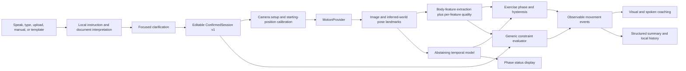

# Relay architecture

## Product boundary

Relay guides and measures a session the user has reviewed and confirmed. Its
seam is a versioned structured session: instruction interpretation produces
that session, and movement intelligence consumes it. Neither layer decides
diagnosis, tissue safety, pain meaning, exercise appropriateness, or progression.

## End-to-end system



The camera and replay providers implement the same `MotionProvider` contract and
emit the same `PoseFrame` shape. Replay therefore replaces perception input,
not the movement or product logic.

## Confirmed session contract

`ConfirmedSession` separates user intent from camera observations. Each
exercise contains side, sets, repetitions, hold, tempo, notes, and zero or more
`MovementRule` values.

A rule is structurally:

```text
constraint(
  scope = joint | relationship | whole-body | temporal,
  joints,
  relationship,
  metric,
  kind = target | minimum | maximum | range | visible-condition,
  value or [min, max],
  unit,
  hard
)
```

The metric identifier is provider-extensible rather than a closed knee-only
enum. Known metrics map to an explicit body scope; an unknown metric can be
registered as a provider-defined body relationship. Zod validates the confirmed
session before camera setup.

The current local interpreter is deterministic and deliberately narrow. It
recognizes the three supported exercises, dose, side, holds, qualitative pace,
minimum rep duration, angle targets/minima/maxima/ranges, and a straight-knee
cue. It asks before assigning an unqualified angle to target or hard-maximum
semantics. Every interpretation remains editable.

## Full-body movement representation

MediaPipe supplies 33 image landmarks plus inferred-world landmarks. Relay uses
the body landmarks needed by each supported feature while retaining a
provider-level full pose contract.

| Exercise | Primary phase feature | Additional evaluated relationships |
|---|---|---|
| Heel slide | Hip–knee–ankle flexion | target/minimum/range/hard maximum, hold, tempo, complete return |
| Straight-leg raise | Movement of the hip–knee–ankle chain from its calibrated start | visible leg straightness and broad shoulder–hip stability |
| Seated knee extension | Extension progress relative to calibrated seated flexion | minimum/target/range, hold, tempo, complete return |

This demonstrates the general pattern across a joint angle, a moving limb
chain, a cross-segment posture relationship, and temporal conditions. It does
not mean that arbitrary new exercises work without implementation. A new
exercise needs a feature extractor with explicit joint dependencies and
quality, phase thresholds or a validated temporal policy, setup copy, and replay
fixtures. The session, evaluator, event, coaching, and summary contracts do not
need to be rebuilt.

## Perception and confidence

The live provider serves MediaPipe Pose Landmarker Full and its WebAssembly
runtime from the application origin. The user can select the front or rear
camera; Relay requests one stream and runs pose inference at approximately
15 Hz. GPU is attempted first, with CPU fallback.

Geometry is computed in aspect-correct source-pixel coordinates and is
corroborated with the provider’s inferred-world output. Current quality inputs
include:

- required landmark presence and visibility;
- whether required joints stay inside the usable frame;
- a minimum 75-pixel projected hip–knee or knee–ankle segment;
- image/world knee-geometry disagreement;
- an inferred out-of-plane ratio;
- availability of the shoulder–hip relationship for straight-leg raises.

Each extracted feature carries `good`, `limited`, or `lost` quality. A spatial
constraint is evaluated only when the matching feature is good and has a value.
When required perception is insufficient, the engine pauses assessment,
explains how to reposition, and does not credit unobserved time to holds or
tempo.

Camera setup requires good geometry held with low primary-feature spread for at
least 1.5 seconds, plus explicit user confirmation that the phone is supported
and the prescribed side faces the camera. Each exercise engine independently
requires at least eight good samples across 1.5 seconds with bounded starting
feature spread before it establishes a neutral baseline and begins counting.

## Movement phases and constraints

The authoritative exercise engine is deterministic and timestamped:

```text
ready → moving → holding → returning → complete
```

Exercise-specific phase features and hysteresis determine a complete excursion
and return. The generic evaluator independently applies the user-confirmed rules
to current feature values and completion timing. It emits typed events such as
target reached, restriction approaching, restriction reached, posture
observation, tempo met/missed, hold short, tracking lost/restored, and
incomplete repetition.

For a hard maximum, the current MVP emits an approach event 10 units before the
configured value and a stop event when the estimate reaches it. These events
are estimates gated by feature quality; they are not a safety guarantee.

The causal temporal model runs at its trained nominal 10 Hz cadence using a
24-frame pose-feature window. It displays confident/caution/unavailable phase
evidence and abstains during warm-up or insufficient visibility. Applicable
`holding` evidence may corroborate an endpoint that has already crossed the
geometric top threshold; applicable `returning` evidence may lower the
geometric reversal requirement from 7 to 4 feature units. It cannot start a
rep, establish that the endpoint was reached, complete a return, or evaluate a
constraint by itself.

## Local-first data flow

- Camera frames and landmarks are held only for the active browser session.
- Uploaded text/PDF/image content is interpreted in browser; the original file
  is not persisted by Relay. Photograph OCR downloads Tesseract worker, core,
  and English language assets on first use, so that path is not first-use
  offline even though Relay does not intentionally upload the selected image.
- Session history stores confirmed plans, feature-keyed rep peaks, per-rule
  events/outcomes, timing, and tracking ratios in `localStorage`. Storage
  failure is non-fatal and leaves the current summary available for export.
- Export uses a versioned JSON structure and is triggered only by the user.
- No account, database, D1 binding, or R2 bucket is used.
- A service worker caches application and local model assets for repeat use.

## Principal decisions

| Decision | Why it fits this MVP | Consequence |
|---|---|---|
| Mobile web with Next.js/React, vinext, and a Cloudflare Worker build | Fast anonymous access and broad phone coverage | Browser camera, speech, performance, and offline behavior vary by device |
| MediaPipe Full as live provider | Shared 33-point image/world contract and best measured active-chain behavior among tested candidates | Synchronous web inference still needs worker and phone optimization |
| Structured session between language and motion | User can correct intent before movement starts | Local parser breadth is intentionally limited |
| Generic scoped constraints over named body features | Generalizes beyond a single angle while keeping rules inspectable | Each new observable feature still needs validated extraction and quality |
| Deterministic rep/constraint authority with learned corroborating phase evidence | Keeps hard rules explainable under an unvalidated temporal model | Learned evidence can refine only geometrically plausible hold/return transitions |
| Shared live/replay pipeline | Repeatable automated failure testing | Replay performance cannot substitute for testing people |
| Structured local storage, no raw video persistence | Supports weak connectivity and user control | Browser-profile storage is not encrypted or synchronized |

## Extension seams

- Replace or add pose SDKs behind `MotionProvider`.
- Register new feature metrics without changing the rule schema.
- Version future real-data temporal artifacts behind the existing edge class.
- Add exercise policies and replay traces while preserving product/session
  flows.
- Move pose inference to a worker without changing the provider consumer.
- Add an optional remote language service behind the structured interpretation
  boundary while keeping explicit confirmation mandatory.
